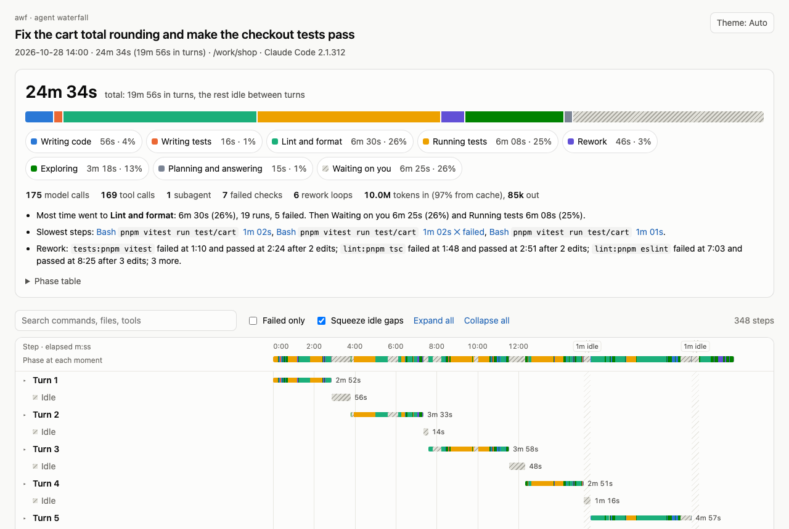

# awf

Find the build, test and lint tax on your coding agents.

awf (agent waterfall) shows where a coding agent's time went, by phase. It runs on your machine and sends nothing anywhere.

<picture>
  <source media="(prefers-color-scheme: dark)" srcset="docs/images/sample-report-dark.png">
  
</picture>

A report of a made-up session. To click through it, open the [sample report](docs/sample-report.html). GitHub shows HTML as source, so download the file and open it in your browser.

```text
$ awf summary last
Session 4045beec · 2026-10-28 23:34 · 9.9s · ~/demo
Task: The sum test fails. Fix it.

Running tests           1.9s ·  20% · 2 runs, 1 failed
Rework                  1.8s ·  18% · 1 edit after 1 failed check
Exploring               2.7s ·  27% · 2 calls
Planning and answering  3.5s ·  35%
Waiting on you          0 ms ·   0%
Unclassified            0 ms ·   0%
Total                   9.9s · 100% · 6 model calls, 5 tool calls, 1 failure
```

## Status

Version 0.1.

- Claude Code is the agent awf is built on. The importers for Codex CLI, Gemini CLI and OpenCode are experimental: they're tested only on hand-made logs, never on a real session. See [docs/other-agents.md](docs/other-agents.md).
- `statusline`, `live` and the pane are Claude Code only.
- awf is used day to day on macOS, where CI runs its tests. CI also builds it on Linux. Windows hasn't been tried.
- Claude Code's transcript format is internal and can change. `awf doctor` reports what it doesn't recognise.
- Phases are heuristics. `awf sample` and `awf accuracy` check them against your own labels.

## Install

awf needs Node 20 or later.

**The Claude Code plugin** records every new session through hooks, the desktop app's included, and adds `/awf:waterfall`, which opens the current session's report:

```bash
claude plugin marketplace add Jccorzo/awf
claude plugin install awf@awf
```

**The CLI** gives you `awf` in a terminal:

```bash
npm install -g agent-waterfall
```

Or run it without installing, with `npx agent-waterfall <command>`. The package is `agent-waterfall` and the command is `awf`; the npm package called `awf` is unrelated.

**From source**, with [pnpm](https://pnpm.io):

```bash
git clone https://github.com/Jccorzo/awf.git
cd awf
pnpm install && pnpm build
npm link
```

`npm link` puts `awf` on your PATH, pointing at `dist/awf.mjs`, so a rebuild takes effect at once. `npm unlink -g agent-waterfall` takes it off. To run the plugin from your clone, use `claude plugin marketplace add /path/to/awf` in place of the first plugin command above, or try it for one session with `claude --plugin-dir plugin`.

### Updates

A plugin installed from GitHub stays on the `version` in its `plugin.json` until a release bumps it, so you get a new version after a release, not after each commit. To update, run these, then restart Claude Code:

```bash
claude plugin marketplace update awf
claude plugin update awf@awf
```

A local clone added as a marketplace is different: Claude Code runs the plugin from that folder, so a rebuild takes effect at each session's next start, or at once with `/reload-plugins`. Sessions already running load it the same way.

The CLI updates with `npm install -g agent-waterfall@latest`.

## Your first report

**With the plugin:**

1. Install it. It records sessions that start after that. A session that's already running starts recording after `/reload-plugins`.
2. Work in Claude Code as usual.
3. Run `/awf:waterfall`. The report opens in your browser, and Claude tells you which phases took the most time.

If you only have the plugin, you use it through its slash commands: `/awf:waterfall`, `/awf:trends` and `/awf:rules`. To run the commands below in a terminal, you need the npm CLI.

**Without the plugin**, awf reads past sessions from their transcripts:

```bash
awf import               # read past sessions, read-only
awf summary last         # one line per phase
awf report last --open   # the HTML waterfall
```

`awf import` reads Claude Code's logs and, experimentally, those of Codex CLI, Gemini CLI and OpenCode.

## Commands

Every command takes `--help` and `--json`. A session is an ID or its first characters, `last`, or the path of a transcript.

```bash
awf sessions                # list sessions, newest first
awf report last --share     # a copy with phases, durations and tool names only
awf compare 14d..7d 7d      # this week against last week, phase by phase
awf stats --since 30d       # Bash time by phase, and what has no rule yet
awf dash --open             # every session in one HTML dashboard, with filters
```

| Command              | What it does                                                        |
| -------------------- | ------------------------------------------------------------------- |
| `sessions`           | Sessions with start time, duration, turns and tool calls            |
| `import`             | Reads past sessions into awf's cache, read-only                     |
| `classify`           | Every step of a session with its phase and the rule that decided it |
| `summary`            | Time per phase, with check runs, failures and rework                |
| `report`             | One self-contained HTML waterfall                                   |
| `dash`               | Every session in one HTML dashboard, by phase, project and period   |
| `compare`            | Two sessions or two date ranges side by side                        |
| `stats`              | Bash time by phase across sessions, and programs that need rules    |
| `statusline`         | The phase split so far, for Claude Code's status line               |
| `live`               | A board of every active Claude Code session                         |
| `sample`, `accuracy` | Check the classifier against your own labels                        |
| `doctor`             | What awf can read, and log entries it doesn't recognise             |
| `purge`              | Deletes everything awf stored                                       |

**Status line.** `awf statusline` shows the current session's phase split in Claude Code's status line. It needs the npm CLI or a build from source. Set it up with [docs/statusline.md](docs/statusline.md).

**Dashboard.** `awf dash --open` draws every session awf has in one HTML file: time by phase, by project and over time, and a table of sessions. Pick the phases to count, a period and a project; leave out Waiting on you to see how the working time splits. It holds session IDs, folder names and timings, no prompts, commands or output.

**Live board.** `awf live` shows every active Claude Code session in a terminal tab, the desktop app's included. See [docs/live.md](docs/live.md).

**Pane.** The plugin keeps the current session's phase split in a pane beside the chat, updated while the agent works. In the desktop app, which shows no status line, it opens by itself. In a terminal, `/awf-panel` opens it.

## Using awf from an agent

While the plugin is enabled, `awf` is on the PATH of Claude's Bash tool, so Claude can run these commands without a separate install, and every command takes `--json`. [docs/agents.md](docs/agents.md) covers the JSON output and how to use it from an agent.

## Phases and rules

Every instant of a session gets exactly one phase, so phase times add up to the session's time: writing code, writing tests, lint and format, running tests, build, rework, exploring, running scripts, planning and answering, and waiting on you. Anything no rule matches stays unclassified. A Bash command is classified by what it really runs, so `npm run test` goes by its script. Edits after a failed check, until the same check passes, are Rework. [docs/phases.md](docs/phases.md) has every rule.

Teach awf your own scripts in `.awf/rules.yaml`: see [docs/rules.md](docs/rules.md). `awf stats` lists the unclassified programs worth a rule. With timing output on, the report nests a build's slowest tasks under its bar: see [docs/build-drilldown.md](docs/build-drilldown.md).

## What awf reads and writes

awf makes no network calls: lint forbids network code in `src/`, the tests run with the network blocked, and the report's page blocks every request.

**Reads, never changes:**

- Claude Code transcripts: `~/.claude/projects/**/*.jsonl` (or `$CLAUDE_CONFIG_DIR/projects`)
- Codex CLI sessions: `~/.codex/sessions/` (or `$CODEX_HOME/sessions`)
- Gemini CLI chats: `~/.gemini/tmp/*/chats/`
- OpenCode storage: `~/.local/share/opencode/storage/` (or `$XDG_DATA_HOME/opencode/storage`)
- In your projects, to classify commands: `package.json`, Makefiles, `deno.json`, Fastfiles, `.awf/rules.yaml`, git hooks (`.git/hooks/`, `.husky/`, `lefthook.yml`, `.pre-commit-config.yaml`), shell scripts a command runs
- Build timing reports a build wrote: `target/cargo-timings/`, `build/reports/profile/`, a `--profile` file

**Writes, only under `~/.awf/`** (or `$AWF_HOME`):

- `events/<session>.jsonl`: the plugin's recorder, one line per hook event: event name, time, tool name, Bash command or file path, the action names of a browser call (`screenshot`, `left_click`), success or failure. Never prompts, tool output, URLs or typed text. Secrets in commands are masked.
- `imported/<session>.json`: `awf import`'s cache of timings, so your history outlives the agents deleting old logs. No prompts or output.
- `reports/<session>.html`: reports, unless you pass `--out`.
- `cache/statusline/<session>.json`: the status line's last line for a session and the transcript size and time it was made from, shared by `awf live`. Lines of sessions untouched for 30 days are deleted.

**The full report** shows commands, file paths, the first prompt and tool output from the transcript, with secrets masked. Keep it to yourself; `--share` makes a copy with phases, durations and tool names only.

**Remove everything:** run `claude plugin uninstall awf@awf` first, because the recorder recreates `~/.awf/` at its next event. Then `awf purge --yes` deletes `~/.awf/`, and `npm uninstall -g agent-waterfall` removes the CLI. Without the CLI, delete `~/.awf/` yourself. Agents' own logs are never touched.

## Troubleshooting

Start with `awf doctor`. It shows where awf reads and writes, whether the recorder is writing, and transcript entries it doesn't recognise. If you only have the plugin, ask Claude to run it.

**"No sessions yet" from `awf sessions`.** It lists only what was recorded or imported, so run `awf import`. If `awf summary last` then says `no sessions found`, awf found no transcripts: the `Reads:` line of `awf doctor` shows where it looked.

**The recorder isn't recording.** `awf doctor` says `Recorder: no events yet`, or its last event is old. The recorder never reports its own errors, so check these:

- `claude plugin list` should show `awf@awf` as enabled.
- Only sessions started after the install are recorded. Start a new one, or run `/reload-plugins`. Turns the recorder missed, before the install or while the plugin was off, still come from the session's transcript.
- The hooks run `node`, so `node` has to be on the PATH Claude Code sees.
- `AWF_DISABLE`, set to anything, turns the recorder off.

**Unknown entries after a Claude Code update.** Run `awf import`, then `awf doctor`, which lists each unknown entry type with its count and the Claude Code versions that wrote it. awf skips them and reads the rest of the session. Please [open an issue](https://github.com/Jccorzo/awf/issues) with the type and version, not the transcript.

**`unknown phase` error.** A bad rule in `.awf/rules.yaml` stops every command that classifies a session. The error names the file and the rule to fix:

```text
awf summary: /path/to/repo/.awf/rules.yaml commands[0]: unknown phase "test"; use one of lint, tests, build, exploring, writing, running, planning, waiting, neutral
```

**The status line shows nothing.** On any error it prints nothing and exits 0, so it can't break Claude Code's status line. It's also empty until the session has some working time. To see the error, run it with `AWF_DEBUG=1`, as in [Try it by hand](docs/statusline.md#try-it-by-hand).

**A context bar or your own status line is gone.** Claude Code runs one status line command, so setting `awf statusline` replaces yours, and awf's line doesn't show context use. Installing the plugin doesn't touch it. [Keep your status line](docs/statusline.md#keep-your-status-line) runs both.

## Documentation

[docs/README.md](docs/README.md) lists everything.

## Contributing

See [CONTRIBUTING.md](CONTRIBUTING.md), [AGENTS.md](AGENTS.md) for coding agents working in this repo, [SECURITY.md](SECURITY.md) to report a security problem, and [CHANGELOG.md](CHANGELOG.md) for what changed.

## Licence

MIT. See [LICENSE](LICENSE).
